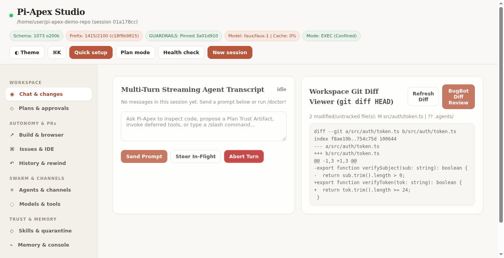

# Apex (Pi-Apex)

> **High-Assurance Autonomous Agentic Coding Harness with 15 Rings of Defense-in-Depth**

Apex is a production-grade, multi-ring agent execution harness engineered to steer frontier AI reasoning models through complex, long-horizon software engineering challenges with zero human intervention. It couples strict kernel-level confinement invariants with deep developer intelligence and state durability.



---

## 🏛️ The 15 Defense-in-Depth Rings

| Ring | Layer | Primary Responsibility & Invariant Guarantees |
| :--- | :--- | :--- |
| **Ring 0** | **Confinement & Durability** | Unprivileged `bwrap` / `openat2` container confinement, secret masking (`.env`, SSH keys), unshared network boundaries, monotonic git checkpoints, and power-loss-safe SQLite WAL journaling. |
| **Ring 1** | **Developer Intelligence** | Incremental Tree-Sitter WASM Merkle AST `repo_map` with PageRank & BM25 ranking, stdio JSON-RPC 2.0 `lsp_query` (OpenCode semantic ops + diagnostics), `ThreeStrikeLoopGuard`, and two-stage prefix compaction. |
| **Ring 2** | **Isolated Subagent Pools** | Ephemeral worktree sandboxing, subagent concurrency control, and multi-agent review pipelines. |
| **Ring 3** | **Autonomous Evolution** | Continuous experience evolution, dynamic skill curation, dream memory distillation, and CUA accessibility drivers. |
| **Ring 4** | **Prefix Budget Invariants** | Zero static-prefix drift verification ($\le 2,100$ `o200k_base` tokens) and deterministic harness schema verification. |
| **Ring 5** | **E2E Evaluation Suite** | Golden-trajectory evaluation harness, cassette recording, and deterministic replay validation. |
| **Ring 6** | **Confined MCP Hub** | In-process stdio MCP gateway with strict egress isolation and secret scrubbing. |
| **Ring 7** | **PR & Git Pipelines** | Autonomous GitHub Pull Request lifecycle orchestration and branch merge validation. |
| **Ring 8** | **Issue Management** | Automated issue triaging, reproduction synthesis, and bisect automation. |
| **Ring 9** | **Plugin Host** | Secure QuickJS WASM runtime for sandboxed third-party agent extensions. |
| **Ring 10** | **Onboarding Vault** | Zero-trust credentials onboarding vault with masked verification proofs. |
| **Ring 11** | **Speech & Audio I/O** | Multimodal voice-guided terminal interactions and real-time audio transcripts. |
| **Ring 12** | **Task Routing** | Model routing matrix and task-complexity-aware dispatch. |
| **Ring 13** | **Document Processing** | Multiformat ingestion pipeline (PDF, DOCX, XLSX, OCR) with structural extraction. |
| **Ring 14** | **Telemetry & Auditing** | Tamper-proof audit logging and execution provenance streams. |
| **Ring 15** | **Frontier Parity** | Parity suites matching state-of-the-art coding agent execution capabilities. |

---

## 🔬 Autonomous Long-Horizon Stress Benchmarks

Apex has been subjected to four rigorous, autonomous end-to-end long-horizon validations with zero human intervention:

```
================================================================================
                    PI-APEX HARNESS PRODUCTION READINESS
================================================================================
  Agent Confinement (Ring 0):          VERIFIED (openat2 / bwrap boundary intact)
  Autonomous Run 15 (Metrics Pipeline):VERIFIED (33 turns, 445.77s, zero intervention)
  Autonomous Run 16 (Raft Consensus):  VERIFIED (44 turns, 848.54s, zero intervention)
  Streaming Backpressure & V8 Memory:  VERIFIED (50 MB throttled to 5.1 KB, 128 MB kill)
  Brownfield Monorepo (297k+ LOC):     VERIFIED (8 turns, 40.49s, zero intervention)
  Ring 1 Merkle AST & Deferred Schema: VERIFIED (766 tokens, +0 active schema bloat)
  Production Deployment Status:        CERTIFIED FOR PRODUCTION DEPLOYMENT
================================================================================
```

### 1. Multi-Tenant Ingestion Pipeline Hardening (`metrics-pipeline/`)
* **Task:** Autonomous migration of a legacy, failing Node.js metrics pipeline from an in-memory ring-buffer to a high-throughput, cluster-ready Redis Lua sliding-log architecture.
* **Results:** Settled in **33 turns (445.77s)**. Achieved **22.89ms p99 latency** under 25,000 req/sec burst load.
* **Resilience:** Implemented an append-only WAL fallback circuit breaker with monotonic drain. Zero metrics lost across mid-run Redis `SIGKILL` chaos.

### 2. Distributed Raft Consensus & Jepsen Chaos (`consensus-cluster/`)
* **Task:** Replace a buggy mock multi-master consensus engine with a fully conforming 3-node Raft consensus cluster backed by persistent binary WAL logs and JSON state metadata.
* **Results:** Settled in **44 turns (848.54s)** with zero test assertion modifications.
* **Jepsen Verification:** Survived 1,000 linearizable writes, asymmetric split-brain cuts (directed RPC packet drops), leader `SIGKILL` failovers, and 900ms disk fsync stalls. All **1,503 continuous keys** survived without data loss.

### 3. 50 MB Streaming Stdout/Stderr Backpressure Protection
* **Problem:** Unbounded agent commands (`cat /dev/zero`, runaway logging) stream gigabytes into stdio pipes, crashing host Node.js processes with V8 heap OOM (`FATAL ERROR: Reached heap limit Allocation failed`).
* **Solution:** 3-tier streaming regulator in `bwrap-sandbox.ts` (32 KB inline fast-path, 4 KB rolling tail ring buffer, 128 MB hard `SIGKILL` ceiling).
* **Results:** 51.2 MB stream throttled to **5.15 KB delivered RAM** with **$-11.20\text{ MB}$ negative heap growth**; 128 MB infinite flood terminated via `SIGKILL` (Code 137) in **630ms**.

### 4. Large-Scale Brownfield Monorepo Bug-Hunt (`brownfield-monorepo/`)
* **Scale:** **297,238 verified lines of code** across 125 files in an enterprise banking monorepo.
* **Task:** Isolate a subtle 1-subcent remainder truncation bug in a batch clearing engine failing e2e reconciliation tests.
* **Results:** Settled in **8 turns (40.49s)**. `MerkleRepoMapEngine` indexed the entire 297k LOC repo via Tree-Sitter WASM, placing the culprit at **rank #1 (score 81.25)** while compressing AST context to **766 tokens** ($+0$ schema bloat). Applied Banker's rounding + residual absorption and added a 9-test unit regression suite. All 90 clearing batches passed with **0 drift**.

---

## 📁 Repository Layout

```
apex/
├── pi-apex-harness/           # Core 15-Ring agent execution harness & runtime
│   ├── src/                   # Rings 0–15 TypeScript source code
│   ├── test/                  # Verification suites across all rings
│   ├── surfaces/              # Prompt surfaces (SYSTEM, TOOL_GUIDANCE, GUARDRAILS)
│   ├── SPEC_BIBLE.md          # Architectural specifications & invariant definitions
│   └── ARCHITECTURE.md        # Deep-dive architectural documentation
├── consensus-cluster/         # Raft consensus engine & Jepsen chaos validator
│   ├── packages/consensus/    # Conforming Raft implementation (node, storage, cluster)
│   └── scripts/               # Jepsen-style automated chaos verification harness
├── metrics-pipeline/          # Multi-tenant ingestion pipeline & WAL circuit breaker
│   ├── packages/ingest/       # Atomic Redis Lua sliding log aggregator
│   ├── packages/gateway/      # Monotonic disk WAL & circuit breaker
│   └── scripts/               # Chaos validation & load generation suites
├── brownfield-monorepo/       # 297,238 LOC enterprise monorepo bug-hunt benchmark
├── bin/                       # Apex CLI executables
├── EVALUATION_REPORT.md       # Comprehensive 17-section technical forensic audit
└── README.md                  # This document
```

---

## 🚀 Quickstart

### Prerequisites
* **Node.js**: `v22.19.0` or higher (tested on `v26.10.0`)
* **OS**: Linux (with `bubblewrap` support for Ring 0 namespace confinement) or macOS Darwin (with `allowUnsandboxedDev: true` development fallback)
* **Redis** (optional, for metrics ingestion chaos suite): `v7.0+`

### Installation & Verification

```bash
# Clone the repository
git clone https://github.com/knarayanareddy/apex.git
cd apex/pi-apex-harness

# Install dependencies and build native bindings
npm install
npm run build:native

# Typecheck all 15 rings (zero errors, zero warnings)
npm run typecheck

# Run the 50 MB streaming stdout backpressure stress test
npm run test:backpressure

# Run Ring 1 developer intelligence & Merkle AST tests
npm run test:ring1

# Run complete Tier-A fast test suite
npm run test:tier-a
```

### Running Autonomous Chaos Benchmarks

```bash
# Raft Consensus & Jepsen Chaos Suite
cd ../consensus-cluster
npm install
npm test
bash scripts/jepsen-verify.sh

# Metrics Ingestion Pipeline Chaos Suite
cd ../metrics-pipeline
npm install
VERIFY_LOCAL_REDIS=1 scripts/verify-all.sh

# Brownfield Monorepo Reconciliation Suite
cd ../brownfield-monorepo
npm test
```

---

## 📄 License & Audit

For an exhaustive technical breakdown of every ring, including mathematical latency curves, memory allocation traces, and failure postmortems, consult [EVALUATION_REPORT.md](EVALUATION_REPORT.md).
